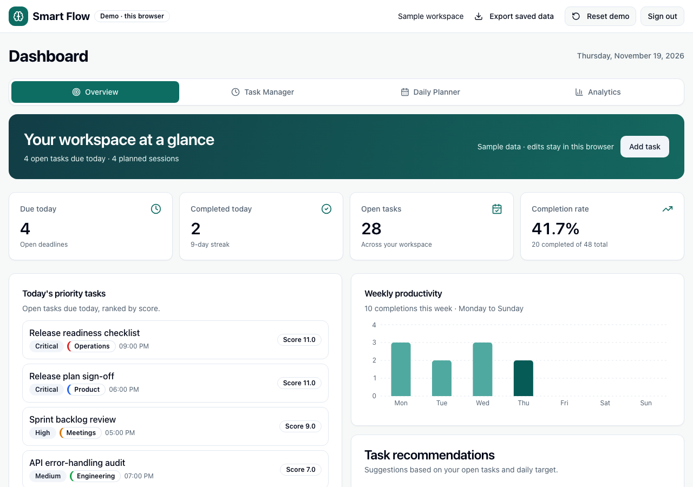
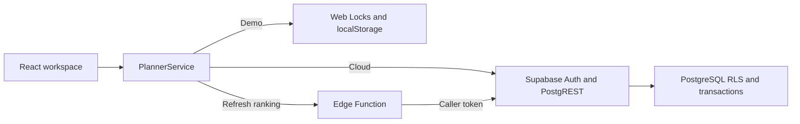

# Smart Flow

Smart Flow is a task planner for people who want to decide what to work on, reserve time for it and review what they finished. Try the shared sample workspace in your browser, or sign in to a Supabase workspace to save tasks across devices.

[](https://github.com/vedpatel-real-ai/smart-flow-ai-planner/actions/workflows/verify.yml)



## Features

| Area | What you can do |
|---|---|
| Tasks | Create, search, filter, edit, categorize, tag, complete and delete tasks. See the saved ranking score on open tasks. |
| Planning | Keep deadlines separate from planned starts. Drag work onto the calendar or enter a date and time with the keyboard. |
| Recurrence | Create a bounded daily, weekly or monthly series. Edit individual dates, update shared details, or delete one occurrence or a series. |
| Recommendations | Review rule-triggered suggestions about your workload. Switch suggestions off independently of ranking. |
| Analytics | Inspect completion history, the current task completion rate, weekly counts, streak and measured durations. |
| Storage | Use browser-local sample data or a signed-in cloud account with row-level security and owner-scoped relationships. |

[Task manager](docs/images/tasks.png) · [Daily planner](docs/images/planner.png) · [Analytics](docs/images/analytics.png) · [Workspace selection](docs/images/entry.png)

## Quick start

Use Node 24 and npm. From a fresh checkout, run:

```sh
npm ci
npm run dev
```

Open [the development app](http://localhost:8080) and choose **Explore Demo**. Use `npm run build` for the production bundle and `npm run preview` to serve it locally. [Development guide](docs/guides/DEVELOPMENT.md) · [Demo workspace guide](docs/guides/DEMO_WORKSPACE.md)

## How it works



React and TypeScript implement the workspace and forms. Radix UI provides dialogs and tabs, dnd-kit handles dragging and Tailwind supplies layout and styling. The selected adapter validates inputs and returns a typed snapshot. After a write the workspace reads current persisted data. The cloud uses Supabase Auth, PostgreSQL and a Deno Edge Function. [Architecture overview](docs/architecture/OVERVIEW.md)

## Demo and cloud workspaces

Both modes use the same dashboard, analytics, task manager and planner. A fresh **Demo** workspace opens with 48 synthetic tasks across six categories, including 20 completed tasks and 28 open tasks. Weekly activity, streaks, ranking and scheduled sessions come from workspace records. Web Locks protect browser-local edits across tabs. Export the saved workspace or use **Reset demo** to replace it after confirmation. [Demo workspace guide](docs/guides/DEMO_WORKSPACE.md)

An empty **Cloud** account shows zero counts and an action to create a first task. Its charts update from the signed-in account’s records. [Empty Cloud workspace](docs/images/cloud-empty.png) · [Populated Cloud workspace](docs/images/cloud-overview.png) · [Cloud analytics](docs/images/cloud-analytics.png)

**Cloud** requires `VITE_SUPABASE_URL` and a public `VITE_SUPABASE_PUBLISHABLE_KEY` or legacy anon key at build time. Sign in or register through the cloud form. The database migrations, Auth configuration and `task-priority` function must be available before inviting users. Local development uses a disposable Supabase project. [Deployment and upgrade guide](docs/guides/DEPLOYMENT.md)

Signing out returns to workspace selection. Each store keeps its own data. A failed cloud login stays on the entry screen. A failed write surfaces an error. A committed task whose score could not be refreshed shows a warning with a separate ranking retry. There is no automatic transfer between stores or offline replay.

## Ranking and recommendations

The score is twice the priority weight (Low 1 through Critical 4), plus deadline urgency (0–3), age (0.5 after seven days) and a short-task bonus (0.3 for 1–30 minutes). A new High task due in two days with a 20-minute estimate scores **8.3**. Larger scores appear first. Fixed rules also identify conditions such as overdue work. The suggestion preference controls those messages. [Formula, thresholds and refresh behavior](docs/architecture/RECOMMENDATIONS.md)

## Scheduling and recurrence

Planned starts reserve a half-open interval of the estimated duration, defaulting to 30 minutes. Adjacent placements are allowed. A deadline can exist without a placement. Recurrences use the browser’s calendar, an interval, and 1–30 occurrences. January 31 clamps to February’s last day and returns to March 31. Scheduling is manual. [Calendar rules and series operations](docs/architecture/SCHEDULING.md)

## Security and reliability

Supabase authenticates cloud sessions. Row policies limit visibility, owner-qualified foreign keys constrain relationships, and transactions protect completion history, concurrent placements and recurring batches. The scoring function authenticates its caller and forwards the same bearer token to the database. Browser-local Demo data is accessible to anyone using the browser profile. [Data model and migration compatibility](docs/architecture/DATA_MODEL.md)

## Testing and evidence

`npm run verify` runs static checks, the production build, unit tests and Edge checks. Database and browser verification also require native PostgreSQL test binaries, Docker and Chromium. CI runs the full set and exports JUnit, logs, exact revision, gate results and checksums. The workflow badge follows main. Each workflow run identifies the checkout it actually tested. [Verification guide](docs/verification/TEST_VERIFICATION.md) · [GitHub Actions runs](https://github.com/vedpatel-real-ai/smart-flow-ai-planner/actions/workflows/verify.yml)

## Technical FAQ

**Does a change in Demo appear in my cloud account?** Each mode writes to its own workspace. Signing in gives you the tasks associated with that cloud identity.

**What happens if I complete the same task twice?** The database serializes the transition and records a single event. Demo performs the equivalent change in one locked storage write.

**How does a task become overdue?** Open tasks whose deadline has passed appear under Overdue. A scheduled start controls calendar occupancy independently.

**Which timezone does the calendar use?** The editor and reports use the browser’s current timezone. The stored timestamps represent instants. [Full technical FAQ](docs/faq.md)

## Project structure

| Location | Purpose |
|---|---|
| [src/components](src/components) | Workspace views, dashboard overview, error boundaries and interaction controls |
| [src/demo](src/demo) | Deterministic synthetic workspace generator and fixture definitions |
| [src/auth](src/auth) and [src/providers](src/providers) | Identity lifecycle, typed service and adapters (Web Locks local store & Supabase) |
| [src/domain](src/domain) | Calendar, scheduling, metrics and analytics rules |
| [supabase](supabase) | SQL migrations and ranking function |
| [tests](tests) | Domain, adapter, database, fixture and browser regression suites |
| [docs](docs) | Architecture, guides, setup and verification |

## Limitations and troubleshooting

Cloud reads require connectivity. The client assembles a workspace snapshot in memory, so large accounts should be benchmarked before rollout. The app currently has a browser-local timezone policy and a bounded recurrence editor. Historical rows without reliable series linkage remain individual tasks. Browser emulation covers representative viewport sizes. Physical touch and screen-reader testing remain release work.

If cloud controls are absent, check the public Vite environment and restart or rebuild. If a placement is rejected, check the entire duration, including work crossing midnight. If a write saved but its rank is stale, check the Edge deployment and use **Refresh ranking**. [More troubleshooting](docs/guides/DEVELOPMENT.md)

## License and attribution

The package metadata credits Ved Patel. This repository has no project license file granting redistribution rights. Third-party packages retain their respective licenses.
